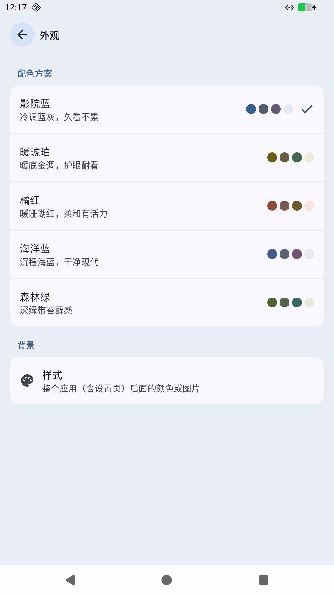

# MyPlayer

一款 Android 本地视频播放器，基于 [NextPlayer](https://github.com/anilbeesetti/nextplayer) 深度定制，为个人使用重新设计：更快到达想看的视频，更少不必要的打扰。

## 截图

| 媒体库（列表） | 媒体库（网格） | 多选操作 | 外观设置 |
| --- | --- | --- | --- |
|  |  |  |  |

## 功能亮点

### 媒体库
- **扫描文件夹白名单**：手动选择要收录的目录（支持 SAF 任意路径），未选择前不显示任何内容——媒体库只呈现你真正关心的视频；已选目录支持勾选与删除
- **列表 / 网格双布局**：顶栏一键切换；长按布局按钮打开快捷设置，排序、布局、浏览模式一次调完
- **1–10 分评分 + 文字点评**：多选操作坞中一键打分，缩略图右上角橙色徽标直观展示；支持按分数排序
- **隐私空间**：独立加密区，视频从公共媒体库消失且文件名被改名隐藏，指纹/PIN 解锁访问，支持一键移回
- **回收站式删除 + 恢复**：误删的记录可在"移除记录"页恢复显示
- **Infuse 风格界面**：卡片式封面、精简顶栏、统一的多选操作坞，无广告无干扰

### 个性化
- **5 套手工调校配色**：影院蓝、暖琥珀、橘红、海洋蓝、森林绿，每套均含完整明暗两版 Material 3 配色
- **应用背景**：支持自定义图片背景，页面全透、卡片半透明，画面干净不蒙灰
- **应用图标**：橙色主题图标与 TV banner

### 播放
- 继承 NextPlayer / Media3 (ExoPlayer) 核心：硬件解码、手势控制（亮度/音量/进度）、倍速、字幕与音轨选择、画中画、后台播放
- 隐私空间内播放不留下任何"继续观看"痕迹

### 隐私优先
- 无网络权限：不联网、不上传、无任何遥测
- 无播放历史页面，去除系统"最近播放"类追踪
- 首次启动零数据，全部内容由你逐步添加

## 与上游的主要差异

上游 NextPlayer 的自动全盘扫描、网络播放（SMB/WebDAV）、播放历史、播放列表、搜索、快速设置磁贴等功能在本分支中**有意移除**，以换取更简单、更私密的使用体验。新增了扫描白名单、评分体系、隐私空间、主题与背景定制等能力。

## 构建

```bash
JAVA_HOME=/path/to/jdk-17 ANDROID_HOME=/path/to/android-sdk ./gradlew :app:assembleDebug
```

产物位于 `app/build/outputs/apk/debug/`，命名为 `MyPlayer-<abi>-v<version>-debug.apk`。

- 最低支持 Android 6.0（minSdk 24）
- 包名 `com.wsgwx.myplayer`

## 许可

本项目遵循上游的 [GPL-3.0](LICENSE) 许可证。感谢 [anilbeesetti/nextplayer](https://github.com/anilbeesetti/nextplayer) 的优秀工作。
