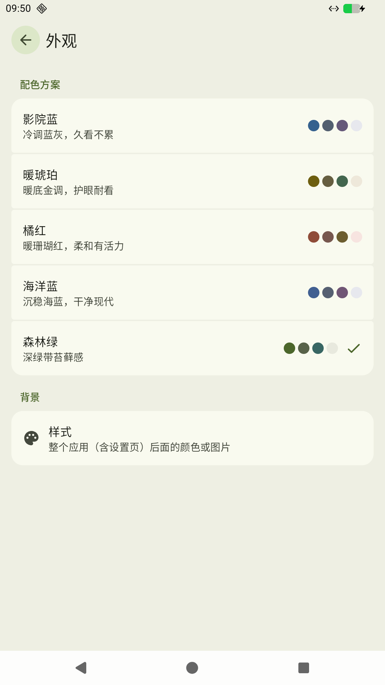

# MyPlayer

个人本地视频播放器，基于开源项目 [Next Player](https://github.com/anilbeesetti/nextplayer) 深度定制，仅供个人使用，非商用。

播放内核为 AndroidX Media3 / ExoPlayer（当前 1.11.1，最新稳定版），界面全部重做为 Infuse / Google Photos 风格。

## 截图

| 媒体库（列表） | 媒体库（网格） |
|:---:|:---:|
|  |  |

| 选中操作条 | 外观设置 |
|:---:|:---:|
|  |  |

## 特性

### 媒体库
- **Infuse 风格卡片**：海报式网格 / 信息式列表，缩略图上叠加时长、播放进度、新片标记与评分徽章
- **1–10 分评分 + 文字评论**：选中视频 → "评分"，为影片打分并写下看点；评分徽章显示在缩略图右上角，可按分数排序（高分在前）
- **按评分排序**：长按顶栏"模式切换"按钮打开快速设置，支持按标题 / 时长 / 路径 / 大小 / 日期 / 评分排序
- **滑动选择 + 浮动操作条**：长按进入多选，底部浮动操作条（播放 / 加密 / 重命名 / 信息 / 评分 / 删除），媒体库与隐私空间共用同一套操作条
- **扫描文件夹白名单**：只显示勾选的文件夹，可添加任意文件夹（SAF）
- **已移除记录恢复**：从媒体库删除只是移除记录，可在"设置 → 媒体库 → 已移除的记录"中单条或全部恢复

### 隐私空间
- 输入 PIN（支持生物识别）进入的隐藏视频空间
- 隐藏 = 移入隐藏目录（O(1) 重命名，无转码无损），取消隐藏即恢复
- 与媒体库一致的手势、卡片与操作条体验

### 外观
- **5 套手调配色方案**（影院蓝 / 暖琥珀 / 橘红 / 海洋蓝 / 森林绿），每套含完整浅色 + 深色 Material 配色
- **图片背景**：可选任意照片作全局背景，原图全清晰显示（不模糊、不压暗），界面以半透明卡片浮于其上
- 深色模式跟随系统

### 交互
- 左滑进入隐私空间，右滑返回
- 顶栏直达外观设置、布局切换、设置

## 构建

```bash
./gradlew :app:assembleDebug
# 输出: app/build/outputs/apk/debug/app-<abi>-debug.apk
```

要求 JDK 17 与 Android SDK。

## 致谢与许可

- 上游项目：[anilbeesetti/nextplayer](https://github.com/anilbeesetti/nextplayer)
- 主题配色方案参考：RKDream
- 本项目沿用上游 [GPLv3](LICENSE) 许可证
