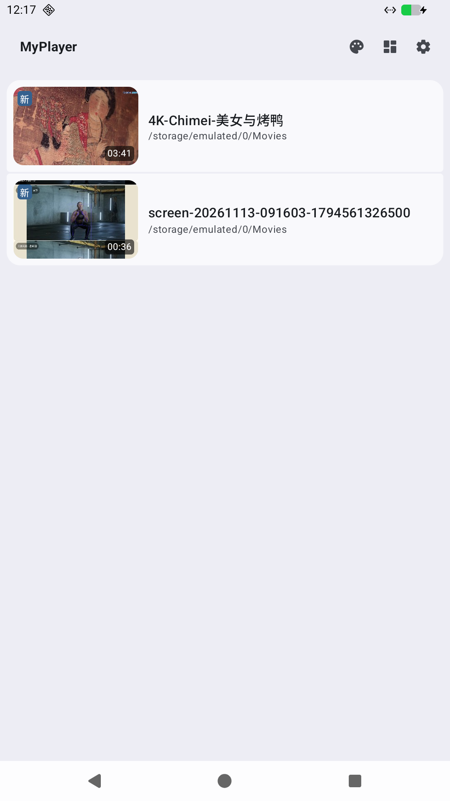
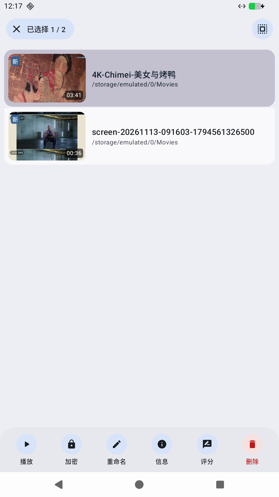

# MyPlayer

一款 Android 本地视频播放器，基于 [NextPlayer](https://github.com/anilbeesetti/nextplayer) 深度定制，方便手机端使用。

## 截图

| 媒体库（列表） | 媒体库（网格） | 多选操作 | 外观设置 |
| --- | --- | --- | --- |
|  |  |  |  |

## 功能亮点

### 媒体库
- **扫描文件夹白名单**：只显示选中目录里的视频，目录可增删
- **列表 / 网格双布局**，顶栏长按打开排序快捷设置
- **1–10 分评分 + 文字点评**，缩略图橙色徽标，支持按分数排序
- **隐私空间**：指纹/PIN 解锁，视频从媒体库消失且文件名被隐藏，支持一键移回
- **删除可恢复**：误删记录可还原显示

### 个性化
- 5 套手工调校 Material 3 配色（明暗双版）
- 自定义应用背景图，卡片半透明不遮画面
- 橙色应用图标与 TV banner

### 播放
- 硬件解码、手势控制、倍速、字幕音轨、画中画、后台播放
- 隐私空间内播放不留任何痕迹

### 隐私优先
- 无网络权限，不联网、无遥测
- 无播放历史
- 首次启动零数据

## 与上游的主要差异

移除了上游的自动全盘扫描、网络播放、播放历史、播放列表、搜索等功能；新增扫描白名单、评分、隐私空间、主题与背景定制。

## 构建

```bash
JAVA_HOME=/path/to/jdk-17 ANDROID_HOME=/path/to/android-sdk ./gradlew :app:assembleDebug
```

产物位于 `app/build/outputs/apk/debug/`，命名为 `MyPlayer-<abi>-v<version>-debug.apk`。

- minSdk 24（Android 6.0）
- 包名 `com.wsgwx.myplayer`

## 许可

遵循上游 [GPL-3.0](LICENSE) 许可证，基于 [anilbeesetti/nextplayer](https://github.com/anilbeesetti/nextplayer)。
